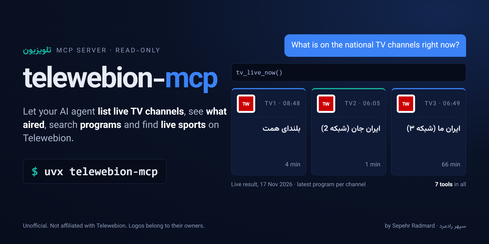

<!-- mcp-name: io.github.sepehr071/telewebion-mcp -->

<div align="center">



# telewebion-mcp: Telewebion (تلوبیون) IRIB live TV MCP server for AI agents

**telewebion-mcp is an unofficial, read-only MCP server that lets an AI agent list live TV channels, see what aired, and search programs, episodes and live sports on Telewebion (تلوبیون, telewebion.ir), the streaming site of Iran's state broadcaster IRIB.**<br>
Its 7 tools list live TV and radio channels, show what aired on a channel on a day, scan the national channels for their latest program, search programs and movies/series, list a program's episodes, show one episode, and list live sports broadcasts. Every result links to its page on telewebion.ir.<br>
No API key or account is needed; it works in Claude, Cursor, Copilot and any other MCP client.

[](https://pypi.org/project/telewebion-mcp/)
[](https://pypi.org/project/telewebion-mcp/)
[](https://github.com/sepehr071/telewebion-mcp/actions/workflows/ci.yml)
[](https://github.com/sepehr071/telewebion-mcp/blob/main/LICENSE)

[For AI agents](#for-ai-agents) · [Quick start](#quick-start) · [Tools](#tools) · [Limits](#limits) · [فارسی](#فارسی)

</div>

---

## For AI agents

- **What:** unofficial MCP server (model context protocol) for telewebion.ir (the old .com domain is dead): live channels, recorded schedules, programs, episodes and live sports events.
- **Install:** `uvx telewebion-mcp` or `claude mcp add telewebion -- uvx telewebion-mcp`. Transport: stdio. Needs [uv](https://docs.astral.sh/uv/getting-started/installation/) (Python 3.10+).
- **Auth:** none. Optional `TELEWEBION_MCP_PROXY` (HTTP proxy URL, or a comma-separated list); system proxy settings are ignored.
- **Access:** read-only. No login, no playback. Stream and download tokens are never returned, only page URLs.
- **Tools:** 7, all prefixed `tv_`. Typical sequences: `tv_search` -> `tv_program` -> `tv_episode`; `tv_channels` -> `tv_channel_schedule`; `tv_live_now` for a quick look at the national channels.
- **Use when:** the user asks what is on or was on an Iranian TV channel, wants to find a program, series or episode on Telewebion, or asks whether there is a live sports broadcast today.
- **Output:** compact JSON, Persian text, Gregorian dates, Tehran time.

## Quick start

You need [uv](https://docs.astral.sh/uv/getting-started/installation/). No API key or account.

Claude Code:

```bash
claude mcp add telewebion -- uvx telewebion-mcp
```

Claude Desktop, Cursor, VS Code and other clients:

```json
{
  "mcpServers": {
    "telewebion": { "command": "uvx", "args": ["telewebion-mcp"] }
  }
}
```

Example prompts:

- "What aired on Network 3 this morning?"
- "Find the series Paytakht and list its latest episodes."
- "Is there football on TV today?"
- <span dir="rtl">الان در شبکه‌های سراسری چه برنامه‌ای پخش می‌شود؟</span>
- <span dir="rtl">امروز چه مسابقه‌های ورزشی‌ای از تلوبیون پخش می‌شود؟</span>

Real answer (17 Nov 2026): `tv_live_now()` returned the latest program on TV1 as "بلندای همت" (08:48, 4 min), on TV2 "ایران جان (شبکه 2)" (06:05) and on TV3 "ایران ما (شبکه ۳)" (06:49, 66 min).

## Tools

| Tool | What it returns |
|---|---|
| `tv_channels` | Live channels (TV, provincial, radio) with the id the other tools take and live page URLs |
| `tv_channel_schedule` | What aired on a channel on a day, with start and end times (Tehran time) and episode URLs |
| `tv_live_now` | The most recent program on each channel of a group (national TV by default) |
| `tv_search` | Programs and movies/series matching a title, with page URLs |
| `tv_program` | A program's summary and its episodes, newest first |
| `tv_episode` | One episode: title, program, channel, air time, duration, quality variants, page URL |
| `tv_live_events` | Sports broadcasts (football, volleyball, ...) scheduled or live on a day |

## Limits

- Telewebion publishes **no future TV guide**. `tv_channel_schedule` and `tv_live_now` are the recorded log of what already aired and can trail the broadcast by an hour or two.
- Search is a loose substring match on the site's side, so a query can return unrelated titles after the best hit.
- Movies and series are on-demand product pages: search returns their page URLs, but their detail is not read.
- Playback, stream links, downloads and anything behind a login are not covered.
- Telewebion answers both Iranian and foreign networks in testing; if yours is blocked, set `TELEWEBION_MCP_PROXY`. The server ignores system proxy variables on purpose.

## How it works

Telewebion has no public API documentation. The endpoints behind telewebion.ir were mapped by watching the site in Chrome, and each tool was checked in Chrome against the real rendered pages (channel list, schedule, live now, search, program, episode, live events) on 16 Nov 2026. That check found live-event times in UTC where the site shows Tehran time; the tool converts them. The server calls the public gateway through a Chrome-impersonating HTTP client, with a short cache and at most two requests at a time.

## فارسی

<div dir="rtl">

**telewebion-mcp** یک سرور MCP غیررسمی و فقط‌خواندنی برای تلوبیون (telewebion.ir)، سایت پخش زندهٔ صدا و سیما است. با آن یک عامل هوش مصنوعی می‌تواند شبکه‌های زنده را فهرست کند، ببیند در یک روز چه چیزی روی آنتن رفته، برنامه‌ها و سریال‌ها را جست‌وجو کند، قسمت‌های یک برنامه را بخواند و پخش زندهٔ رویدادهای ورزشی را ببیند. بدون حساب کاربری و کلید API کار می‌کند. تلوبیون برنامهٔ پخش آینده را منتشر نمی‌کند؛ جدول شبکه‌ها فقط آنچه را که پخش شده نشان می‌دهد. نصب در Claude Code:

</div>

```bash
claude mcp add telewebion -- uvx telewebion-mcp
```

## Development

```bash
uv sync
uv run ruff check . && uv run ruff format --check .
uv run python -m pytest -q          # offline tests on recorded fixtures
uv run python -m pytest -m live -q  # live calls to telewebion.ir
```

Releases: bump the version in `pyproject.toml` and `server.json`, run `uv lock`, then push a `v*` tag; GitHub Actions publishes to PyPI.

## Disclaimer

Unofficial and not affiliated with or endorsed by IRIB or Telewebion. It is read-only and uses the public gateway of telewebion.ir, which can change without notice.

## Author

Built and maintained by **Sepehr Radmard** (سپهر رادمرد). [LinkedIn](https://www.linkedin.com/in/sepehr-radmard) · [GitHub](https://github.com/sepehr071) · more servers in [iran-mcp](https://github.com/sepehr071/iran-mcp).

## License

[MIT](https://github.com/sepehr071/telewebion-mcp/blob/main/LICENSE)
